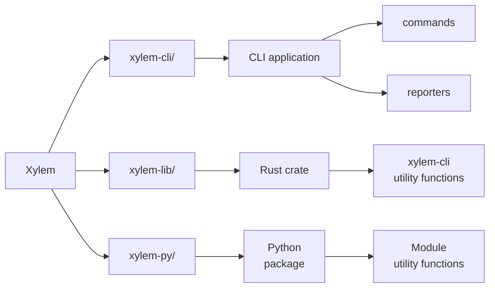

# Architecture
> This file describes the high-level architecture and some specific design decisions of Xylem

## Components
- `xylem-cli` (CLI Application)
  - Depends on `xylem-lib`
  - Depends on [clap](https://docs.rs/clap/latest/clap/) crate for CLI arguments
  - Contains code for CLI [commands](./xylem-cli/src/commands/) (e.g., `run`, `check`, etc...) and [reporters](./xylem-cli/src/reporters/)
- `xylem-lib` (Rust code)
  - Utility functions
  - Code for handling user input, ingesting configuration data, running workflows, etc...
- `xylem-py` (Python library)
  - 🚧 Under construction
  - Export Rust code as Python library using [PyO3/Maturin](https://github.com/PyO3/maturin)
  - Export select `xylem-lib` functions as Python functions

## Diagram

## Notes
- Tests are written for modules in adjacent `tests.rs` files within the associated module directory
- Generated documentation is published to [https://xylem.ornl.gov](https://xylem.ornl.gov)