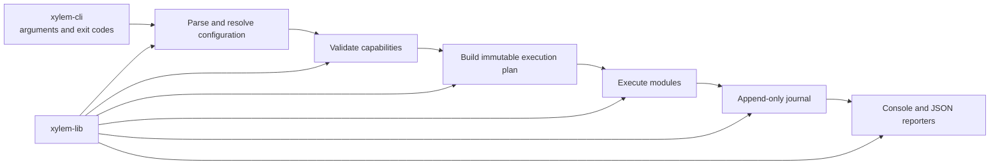

# Architecture
> This file describes the high-level architecture and some specific design decisions of Xylem

## Components
- `xylem-cli` (CLI Application)
  - Depends on `xylem-lib`
  - Depends on [clap](https://docs.rs/clap/latest/clap/) crate for CLI arguments
  - Contains code for CLI [commands](./crates/xylem-cli/src/commands/) (e.g., `run`, `check`, etc...)
- `xylem-lib` (Rust code)
  - Utility functions
  - Code for handling user input, ingesting configuration data, running workflows, persisting versioned execution journals, and rendering console and JSON run summaries via `RunSummary`

Execution journals are append-only JSON Lines files owned by `xylem-lib`.
They are flushed at every input and module transition and can be recovered
after interruption. `RunSummary` renders console and JSON summaries from that
durable state, keeping presentation separate from execution facts.

Reusable library operations return capability-owned errors with source chains
and path, module, or working-directory context. Configuration, planning,
acquisition, requirements, templates, module loading, child processes,
completion, and journals remain distinct classifications. Workflow outcomes
store their durable error text, while `xylem-cli` exclusively owns exit-code
selection and terminal presentation.

## Diagram

## Notes
- Tests are written for modules in adjacent `tests.rs` files within the associated module directory
- Generated documentation is published to [https://xylem.ornl.gov](https://xylem.ornl.gov)
