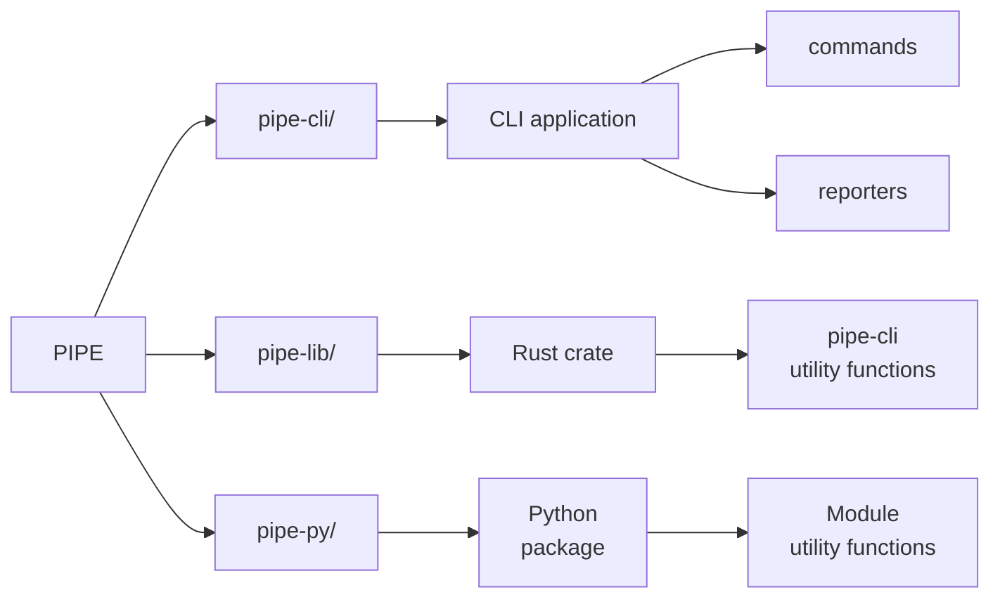

# Contributing
## Setup Development Environment
- Ensure [Docker](https://www.docker.com/products/docker-desktop/) (or [Podman](https://podman.io/)) is installed
- Start a container using
    ```docker
    docker run -it --name <NAME> -p 1337:1337 ghcr.io/jhwohlgemuth/rust
    ```
- Within your container, clone the project <sup>[1](#1)</sup> with
    ```shell
    git clone git@code.ornl.gov:GSHS/common/pipe/command.git
    ```
- Ensure Docker container is running, then chose one of more of the following:
    - Open a web browser <sup>[2](#2)</sup> and navigate to `https://localhost:1337` (password = `password`)
    - Open local install of VS Code and connect to container using [remote development extension](https://marketplace.visualstudio.com/items?itemName=ms-vscode-remote.vscode-remote-extensionpack)
- Install [Tarpaulin](https://github.com/xd009642/tarpaulin) for generating code coverage with
    ```shell
    cargo install cargo-tarpaulin
    ```
- Development involves mulitple [make](./Makefile) and cargo tasks:
    - `cargo run` - Execute code
        - `cargo run -- help` - Print PIPE CLI help
        - `cargo run -- check --help` - Print check command CLI help
        - `cargo run -- run --config /path/to/config.json --dry-run -vvv` - Run workflow dry run with logging
    - `make lint` -  Format and lint code
    - `make test` - Run tests and generate code coverage
    - `make doc` - Generate documentation (see https://pipe.ornl.gov)
    - `make build` - Build release binaries
- Make a git branch, push changes to it, open a merge request, resolve issues

## Cross-platform testing
- Ensure your environment has either [Docker](https://www.docker.com/products/docker-desktop/) or [Podman](https://podman.io/) installed and running
- Running cross-platform tests requires using [Cross](https://github.com/cross-rs/cross). Install Cross with
    ```shell
    cargo install cross --git https://github.com/cross-rs/cross
    ```
    or use `cargo-binstall`<sup>[3](#3)</sup>.
- Run tests for a given target triple<sup>[4](#4)</sup> with
    ```shell
    cross test --target <target triple>
    ```
- ***OR*** run all<sup>[5](#5)</sup> cross-platform tests with
    ```shell
    make test-cross
    ```

## Project Structure


## Coding Guidelines
- Logging
    - This project uses the [tracing](https://docs.rs/tracing/latest/tracing/) crate for logging
    - Printing file content should be logged using `dimmed()`
    - Prefix messages with `=> [KEYWORD]` where `"KEYWORD"` can be
        - `"DRYRUN"` (yellow) = print script that would be executed
        - `"ENV"` (dimmed) = environment variables
        - `"FAIL"` (red) = used within `Script::run`
        - `"FOUND"` (green) = find files or meet requirements
        - `"NOTFOUND"` (red) = do not find files or have unmet requirements
        - `"OUTPUT"` (dimmed) = print script output
        - `"READ"` (green) = file is read successfully
        - `"RUN"` (yellow) = execute script
    - Choosing the level
        - `warn!`
            - Anytime code is run (e.g., `script.run()`)
            - When fallback default values are used (e.g., `"template.json"`)
        - `info!`
            - Anytime a criteria is met that would otherwise cause failure (ex. finding a necessary file)
            - When code would be run (e.g., during `--dry-run` usage)
        - `debug!` = underlying variables and processes that can provide context and clarity
        - `trace!` = Script output and details not normally needed unless troubleshooting

---

[1]
---
> To setup SSH, please see the [Setup SSH wiki page](https://code.ornl.gov/groups/geoai/common/-/wikis/Setup-SSH)

> **Note**:
> You can copy your local SSH key with `docker cp /path/to/.ssh/id_ed25519 <NAME>:/root/.ssh` and run `fix_ssh_key_permissions` within your container to get setup without making a new key pair

[2]
---
> Firefox is strongly recommended

[3]
---
> Install `cargo-binstall` with
```shell
curl -L --proto '=https' --tlsv1.2 -sSf https://raw.githubusercontent.com/cargo-bins/cargo-binstall/main/install-from-binstall-release.sh | bash
```
> Install `cross` with
```shell
cargo binstall cross
```
> See [cargo-binstall README](https://github.com/cargo-bins/cargo-binstall?tab=readme-ov-file#installation) for more options

[4]
---
> See [list of supported targets](https://github.com/cross-rs/cross?tab=readme-ov-file#supported-targets)

[5]
---
> See the `TARGETS` variable in [./Makefile](https://code.ornl.gov/GSHS/common/pipe/command/-/blob/main/Makefile?ref_type=heads#L31)